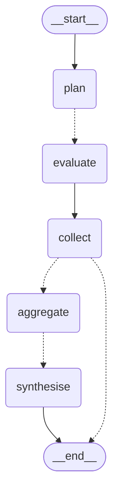

# Technology Stack

Every technology used in the GD Platform, organised by the slice it serves, with
the reason it was chosen. Versions are pinned — `claude.md` requires it, so that
a score produced today can be reproduced later.

**Runtimes:** Python 3.13.5 · Node 24.11.0 · npm 10.9.0 · Docker 29.2.1
**Scale:** 79 source files / 10,010 lines · 20 test files / 4,507 lines ·
301 tests · 38 endpoints · 11 pages · 4 migrations

---

## The one decision that shapes everything

The system draws a hard line between what is **measured** and what is
**inferred**. It is not a stylistic preference — it decides which technology is
allowed where.

| Computed in code — no model involved | Inferred by a model |
|---|---|
| Speaking time, turns, interruptions, response latency | Per-dimension scores (0–10) |
| Participation share, interaction graph | Strengths, weaknesses, evidence citations |
| **The final score** (fixed weighted formula) | Rolling-state observations |
| Agent selection, weight renormalisation | The report narrative |
| Speaker attribution | — |

Consequences you can see in the stack: no ML library appears in the metrics
engine, `aggregator.py` imports nothing from `services/llm/`, and the synthesis
agent reaches the final score through a **tool** rather than arithmetic of its
own.

---

## Slice 00 — Shared foundation

`services/common/` — used by every slice below.

| Technology | Version | Role |
|---|---|---|
| Pydantic | 2.10.4 | Contracts, request/response validation |
| pydantic-settings | 2.7.0 | `.env` configuration |
| SQLAlchemy (async) | 2.0.36 | ORM |
| asyncpg | 0.30.0 | PostgreSQL driver |
| greenlet | 3.1.1 | SQLAlchemy's async bridge |
| Alembic | 1.14.0 | Migrations (4) |
| redis (asyncio) | 5.2.1 | Redis Streams event bus |
| jsonschema | 4.23.0 | Contract validation gate |

**Why `jsonschema` alongside Pydantic.** The JSON Schema files in
`claude/docs/contracts/` are the canonical spec; the Pydantic models are the
runtime enforcement. Validating built instances against the schema files
*themselves* means the two cannot silently drift apart — which is the specific
failure the contracts README warns about.

---

## Slice 01 — Auth · FR-01, FR-02

| Technology | Version | Role |
|---|---|---|
| FastAPI | 0.115.6 | Routing, `HTTPBearer` |
| PyJWT | 2.10.1 | HS256 access + refresh tokens |
| bcrypt | 4.2.1 | Password hashing |
| email-validator | 2.2.0 | Registration validation |
| PostgreSQL | 16.4-alpine | `users`, `profiles`, `refresh_tokens` |

**Detail worth knowing.** Passwords are SHA-256 pre-hashed before bcrypt,
because bcrypt silently truncates input past 72 bytes — without the pre-hash a
long passphrase is quietly weakened.

---

## Slice 02 — Session & Lobby · FR-03 – FR-07, FR-10, FR-11

| Technology | Version | Role |
|---|---|---|
| FastAPI + SQLAlchemy | — | `gd_sessions`, `participants`, `speech_events` |
| Python `StrEnum` + dicts | stdlib | Three state machines |
| `secrets` | stdlib | Join codes |

**No state-machine library.** The transition tables *are* the specification —
`CREATED → WAITING → READY → STARTING → LIVE → ENDING → ENDED → EVALUATING →
COMPLETED`, plus participant and evaluation machines. A library would hide the
one thing a reader needs to see. Illegal transitions raise rather than mutate.

Join codes use an alphabet without `0/O` or `1/I`, because codes get read aloud.

---

## Slice 03 — Realtime · FR-08, FR-09

| Technology | Version | Role |
|---|---|---|
| LiveKit Server | v1.8.0 (Docker) | SFU — the media plane |
| livekit-client | 2.7.3 | Browser WebRTC SDK |
| PyJWT | 2.10.1 | LiveKit access tokens |
| FastAPI / Starlette WebSocket | — | Control plane |
| `uvicorn[standard]` | 0.34.0 | ASGI server (brings `websockets`) |
| `asyncio` | stdlib | 1 Hz timer ticker, in-process hub |

**Two planes, deliberately separate.** Audio and video go through LiveKit;
timer, roster and lifecycle events go over a WebSocket. A media failure and a
control failure are then independent problems.

**No LiveKit server SDK.** Tokens are minted directly with PyJWT — a 70-line
file — keeping the media integration thin enough to swap. The claim shape was
verified against current LiveKit documentation rather than written from memory,
as `claude.md` requires.

**No Redis pub/sub for fan-out.** One backend instance, so the hub is a `dict`
guarded by an `asyncio.Lock`. The Redis fan-out in design §42 is the scale
target and is deliberately not built.

---

## Slice 04 — Speech · FR-12 – FR-16

| Technology | Version | Role |
|---|---|---|
| MediaRecorder API | browser | 45-second Opus/WebM windows |
| python-multipart | 0.0.20 | Upload parsing |
| faster-whisper | 1.1.0 *(optional)* | Local Whisper STT |
| MinIO | RELEASE.2024-09-13 | S3-compatible audio retention |
| httpx | 0.28.1 | MinIO S3 calls |

**Speaker attribution is exact, not inferred.** Each browser records only its
own microphone, so the server knows whose audio it received. No diarization
model, no error rate. A `Diarizer` protocol exists for the mixed-stream case
that this deployment never hits.

**No boto3.** Three operations against one local container did not justify the
dependency tree; `httpx` was already present.

**STT is optional by design.** `STT_PROVIDER=auto` uses Whisper when installed
and falls back to a deterministic stub otherwise, so the pipeline runs before a
~150 MB model download. *Currently running on the stub.*

---

## Slice 05 — Metrics & Observer · FR-17, FR-18

| Technology | Version | Role |
|---|---|---|
| `re`, `dataclasses`, `collections` | stdlib | The entire metrics engine |
| LLM layer | — | Observer Agent only |

**No numpy, no pandas, no ML.** Every metric is a count or a duration derived
from speech events. A library would add a dependency and nothing else. This is
also what makes the numbers reproducible — the same session always yields the
same figures.

**The Observer cannot score.** `rolling_state.schema.json` has no score field,
so a model attempting one fails validation. The constraint is structural, not a
prompt request.

---

## Slice 06 — Evaluation · FR-19 – FR-31

The agentic core. Covered in full below.

| Technology | Version | Role |
|---|---|---|
| Redis Streams | 7.4-alpine | Durable queue, consumer groups, DLQ |
| **langgraph** | **0.2.60** | **Workflow orchestration (state graph)** |
| langgraph-checkpoint | 2.1.2 | Checkpointer interface |
| langchain-core | 0.3.86 | LangGraph dependency |
| `asyncio` | stdlib | `native` fallback engine, concurrency |
| openai | 1.59.6 | LLM adapter |
| anthropic | 0.42.0 | LLM adapter |
| Pure Python | — | Aggregator, report assembly |

---

## Slice 07 — Notifications · FR-32

| Technology | Version | Role |
|---|---|---|
| FastAPI + SQLAlchemy | — | `notifications` table |
| WebSocket + polling | — | Live push, 30 s top-bar poll |

Durable rows rather than fire-and-forget broadcasts, because the notification
that matters most — *your evaluation is ready* — arrives when the candidate has
closed the tab. There is no email transport: nothing here is hosted, so there is
no mail service to deliver to.

---

## The agentic architecture

LangGraph supplies the workflow machinery — state, dynamic fan-out, conditional
routing, checkpointing. What it does not supply, and what this project had to
decide for itself, is everything that makes the evaluation *trustworthy*: which
specialists run, what evidence each one sees, what a valid response is, and
which side of the determinism boundary each stage falls on.

### Orchestration: LangGraph

**`langgraph` 0.2.60** (`langgraph-checkpoint` 2.1.2, `langchain-core` 0.3.86).
The evaluation workflow is a compiled `StateGraph` in
`services/evaluation/graph.py`.



*Generated by `render_mermaid()` from the compiled graph — it cannot drift from
the code.* Dotted edges are conditional; solid are fixed.

**Why LangGraph and not CrewAI or AutoGen.** The specialist roster is chosen at
runtime from the GD type (design §22), so the number of parallel branches is not
known until `plan` has run — that is exactly what LangGraph's `Send` API exists
for, and an `operator.add` reducer on `runs` merges the branches back with no
collection code. CrewAI and AutoGen are both built around agents *delegating to
and conversing with* one another; this design deliberately has no inter-agent
conversation, so those abstractions would be worked around rather than used.
LangGraph also supplies two things that map onto requirements already in the
design document: checkpointing for resume-on-failure (§38, §39) and `interrupt`
for human-in-the-loop review (§52).

**Nodes.** `plan` → `evaluate` (fan-out) → `collect` → `aggregate` →
`synthesise`. A conditional edge from `collect` routes to `END` when every
specialist failed, so the graph cannot fabricate a report from nothing.

**`aggregate` is a node, not an agent.** It calls the same deterministic
aggregator and imports nothing from the LLM layer — there is a test asserting
that. Adopting a framework did not move the determinism boundary.

**Checkpointing is off by default, deliberately.** `MemorySaver` is in-process,
so it cannot survive the worker crash it would exist to protect against — while
the `operator.add` reducers mean a resumed thread *appends* to what it held.
That combination silently duplicates every candidate's assessment; it did, and
a test now covers it. Durable resume needs `langgraph-checkpoint-postgres`
against the same database, and `build_graph()` takes a checkpointer for that.

`EVALUATION_ENGINE=native` runs the same stages under plain `asyncio` instead.
Both engines produce identical scores on identical input — verified — so the
two are comparable on the same session.

### The specialists are data, not classes

```python
@dataclass(frozen=True, slots=True)
class EvaluatorAgent:
    name: str; dimension: str; focus: str; rubric: str
    metrics_led: bool = False
```

Six instances: Content, Communication, Leadership, Collaboration, Critical
Thinking, Behaviour. They perform the identical operation and differ only in
prompt, so six subclasses would be ceremony. `AGENTS_BY_GD_TYPE` selects the
roster from the GD type — that mapping is what makes the pipeline agentic rather
than a fixed script.

### Dispatch: batched per dimension

`EVALUATION_STRATEGY` switches between two strategies that produce identical
downstream data:

| Strategy | Calls (6 candidates, technical GD) | Trade-off |
|---|---|---|
| `per_dimension` *(default)* | **5** | Context sent once per specialist. Comparative dimensions can compare. |
| `per_candidate` | 30 | Each response small; `candidate_id` pinnable to one value. |

Batching is design §49 — *"avoid sending enormous duplicate prompts to every
agent"* — and it is also better evaluation: leadership and dominance only mean
something relative to the group, and a judge that sees all six can rank them.

Two risks it introduces, both handled: the system prompt states that 5 means
*average for this dimension*, **not** *average for this group*, so a strong
group does not deflate everyone; and `parse_batch_output` rejects a duplicated
or skipped candidate — the two failures a schema cannot express.

### The LLM layer: a Protocol with two methods

`services/llm/base.py` defines `LLMProvider`. Three adapters implement it, and
nothing outside that folder knows a vendor exists.

| Adapter | Structured output | Tool use |
|---|---|---|
| `anthropic_provider` | `output_config.format` | `tool_use` content blocks; assistant turn echoed back verbatim |
| `openai_provider` | `response_format` + strict-subset detection | `tool_calls` on the message; results as `role: "tool"` |
| `stub_provider` | Deterministic synthesis from `sha256(prompt)` | Calls every tool once, then answers |

**Strict-mode detection.** OpenAI's strict mode accepts only a subset of JSON
Schema — every property required, no open objects or maps. `evaluation_output`
qualifies; `rolling_state` does not (optional `observations`, and
`candidate_positions` is a string map). The adapter detects this per schema.
Claiming strict for a schema that does not qualify is a 400 on every call.

### Two structural guarantees

1. **An agent cannot score the wrong person.** In the per-candidate path the
   response schema pins `candidate_id` to a single-value enum. In the batched
   path it is an enum of the real labels plus a uniqueness check.
2. **No agent can emit a final score.** `evaluation_output.schema.json` has no
   field for one.

### Validation gate

Every response passes `parse_agent_output` — Pydantic model *and* raw JSON
Schema — before reaching the aggregator. Malformed output raises `ContractError`
and retries. Nothing unvalidated reaches a score.

### Durability

Redis Streams with consumer group `evaluation-workers`, `XAUTOCLAIM` for workers
that die mid-job, three attempts, then a dead-letter stream. Delivery is
at-least-once, so correctness comes from the database:
`UNIQUE(session_id, evaluation_version)` — design §39's idempotency key,
enforced by Postgres rather than by convention.

### The synthesis agent has tools, not arithmetic

The last stage, and the only place a model sees a candidate holistically. It
writes the narrative; it does not compute the number.

```
compute_final_score()                        → reads stored scores + rubric
score_if(dimension, hypothetical_score)      → re-runs the same aggregator
```

`compute_final_score` **takes no arguments**. Both handlers close over data
already persisted and call `aggregator.aggregate_candidate` — they are not a
second implementation of the formula, they *are* the formula. The model chooses
which question to ask; the answer always comes from code.

The what-if tool is what makes this better than passing the number in the
prompt: feedback can say *"collaboration at 8.0 instead of 5.2 would have put
you at 79"* and be arithmetically true. Every tool call is stored on the report,
so a narrative's provenance is auditable.

---

## Frontend

| Technology | Version | Role |
|---|---|---|
| Next.js (App Router) | 15.1.3 | Framework, 11 routes |
| React | 19.0.0 | UI |
| TypeScript | 5.7.2 | Strict mode |
| livekit-client | 2.7.3 | WebRTC |

**No state library, no UI kit, no CSS framework.** Native `WebSocket`, `fetch`
and `MediaRecorder`; hand-written CSS with custom properties. The app has one
piece of genuinely hard client state — the live session — and that lives in a
single hook driven by server events.

---

## Observability

| Technology | Version | Role |
|---|---|---|
| prometheus-fastapi-instrumentator | 7.0.2 | `/metrics` endpoint |
| Prometheus | v2.54.1 | Scraping |
| Grafana | 11.2.0 | Dashboards |

---

## Testing & quality

| Technology | Version | Role |
|---|---|---|
| pytest | 8.3.4 | 301 tests |
| pytest-asyncio | 0.25.0 | Async tests |
| httpx | 0.28.1 | ASGI transport |
| aiosqlite | 0.20.0 | In-memory test database |
| Starlette TestClient | — | WebSocket tests |
| ruff | 0.8.4 | Lint + format |
| tsc | 5.7.2 | Frontend typecheck |

The suite runs with **no Docker, no Redis, no model download and no API key** —
STT, LLM and object storage all default to offline implementations. A live
end-to-end smoke test against real Postgres and Redis covers what unit tests
structurally cannot; it caught two bugs that the suite could not.

---

## Deliberately not used

The absences are decisions, and each has a reason.

| Not used | Why |
|---|---|
| **CrewAI / AutoGen** | Both centre on agents delegating to and conversing with each other. This pipeline is fan-out/fan-in with no inter-agent conversation, so their core abstraction would be worked around rather than used. LangGraph models the graph directly. |
| **Kafka** | Redis Streams provides consumer groups, retry, DLQ and backpressure. Kafka is the scale target (design §54), not the MVP. |
| **Vector database** | Nothing in the workflow does semantic retrieval. Design §35 lists it as optional and it stays unbuilt. |
| **boto3 / MinIO SDK** | Three S3 operations against one local container. `httpx` was already a dependency. |
| **LiveKit server SDK** | Token minting is one PyJWT call. A vendor SDK would thicken the interface it is meant to keep thin. |
| **numpy / pandas** | Every metric is a count or a duration. |
| **A state-machine library** | The transition table is the specification and should be readable. |
| **Redux / Zustand / Tailwind / shadcn** | One hard piece of client state, one hook. |
| **Cloud SDKs, Terraform, k8s, CI deploy** | `claude.md` forbids them: this runs on one machine at `localhost`, by design. |
| **An LLM aggregator** | The final score must be reproducible, explainable and comparable across sessions. A model is also worse at weighted arithmetic than code. |

---

## Configuration switches

Everything below can be changed in `.env` without touching code.

| Setting | Options | Default |
|---|---|---|
| `LLM_PROVIDER` | `anthropic` · `openai` · `stub` | `stub` |
| `LLM_MODEL` | any model the provider serves | `claude-opus-5` |
| `STT_PROVIDER` | `auto` · `whisper` · `stub` | `auto` |
| `OBJECT_STORE` | `minio` · `filesystem` | `filesystem` |
| `EVALUATION_ENGINE` | `langgraph` · `native` | `langgraph` |
| `EVALUATION_STRATEGY` | `per_dimension` · `per_candidate` | `per_dimension` |

Rubric weights are per session and set by the host, so the scoring policy is
data rather than code.
