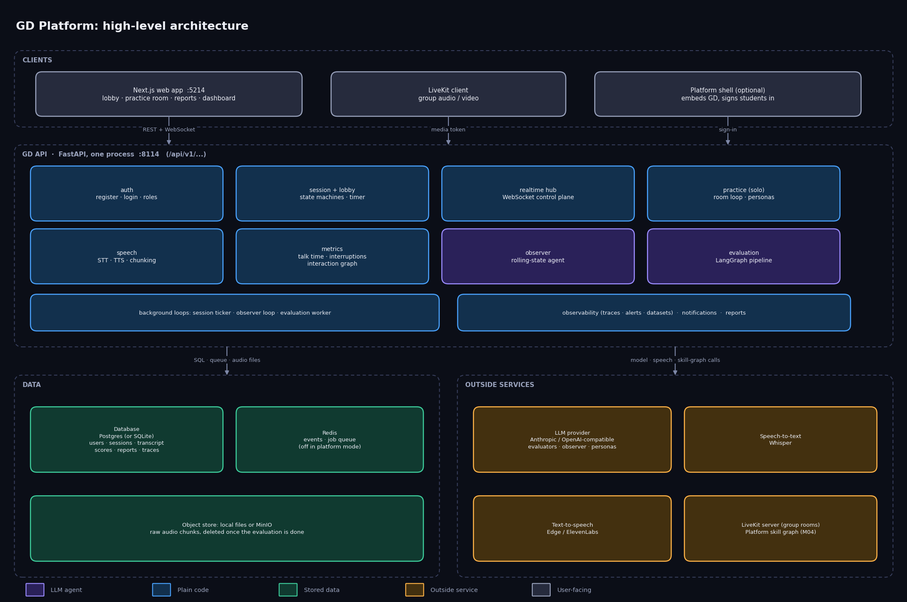
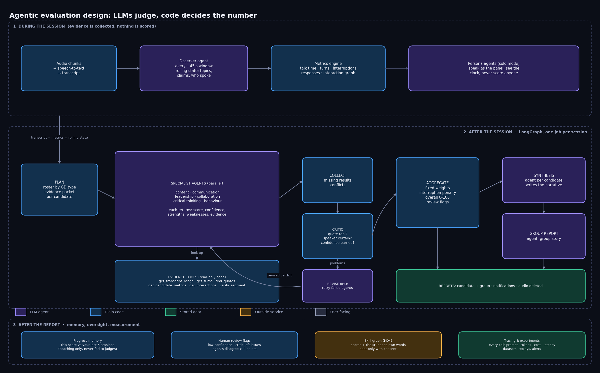
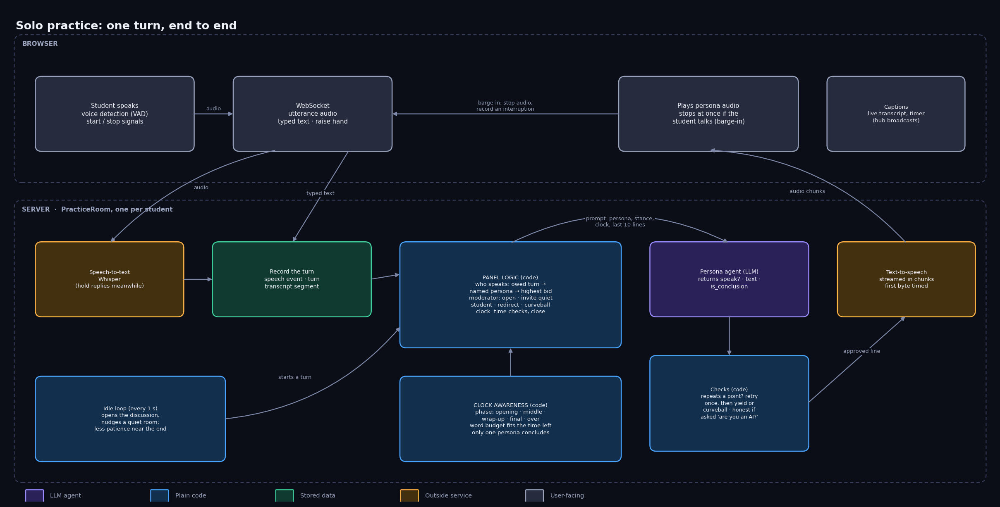

# GD Platform: system design

A group-discussion (GD) practice and evaluation platform. Students take part in a
discussion (with other people, or alone against AI personas), and the system produces an
evidence-backed report on each student. This document describes the whole system, then the
agentic part in detail. Pictures are in `docs/` and are regenerated with
`python docs/make_system_diagrams.py`.

Colour key used in every picture: purple = an LLM agent, blue = plain deterministic code,
green = stored data, orange = a service outside this system, grey = what the user touches.

---

## 1. High-level design

### Shape of the system

One web front end, one backend process, a database, and a handful of outside services. The
backend is a single FastAPI application (`services.main:app`, port 8114) made of one package
per concern. Everything runs on one machine; there is no separate worker service.

### Clients

- **Next.js web app** (port 5214): lobby, the practice room, live room, reports, history,
  and the Observability dashboard (hosts and admins).
- **LiveKit client**: carries audio and video in group sessions.
- **Platform shell** (optional): when GD runs inside the wider platform it is embedded in
  its page, and students arrive already signed in.

### Backend packages

| Package | Job |
|---|---|
| auth | Accounts, login, tokens, roles (candidate, host, admin). |
| session, lobby | Session state machine (waiting, ready, live, ending, ended, evaluating, completed), timer, lobbies, participants. |
| realtime | WebSocket hub: speech start/stop, transcript lines, timers, evaluation-done events. |
| practice | Solo mode: one `PracticeRoom` per student, the AI panel, the clock. |
| speech | Audio chunking, speech-to-text, text-to-speech, transcript storage. |
| metrics | Deterministic numbers: talk time, turns, interruptions, responses, interaction graph. |
| observer | An LLM agent that keeps a rolling summary of the discussion. |
| evaluation | The LangGraph pipeline, scoring, reports, queue and worker. |
| notifications | In-app inbox ("your report is ready"). |
| observability | Tracing of every model and speech call, alerts, datasets, experiments. |

Three background loops run inside the same process: the session ticker (timers and phase
changes), the observer loop, and the evaluation worker. None is on the request path, and each
contains its own failures.

### Data

- **Database**: Postgres by default, SQLite in platform mode. Holds accounts, sessions,
  transcript segments, speech events, turns, evaluation jobs, per-agent verdicts, scores,
  reports, and trace spans.
- **Redis**: event bus and the evaluation job queue. Switched off in platform mode.
- **Object store**: raw audio chunks, on local disk or MinIO. Audio is deleted once the
  session's evaluation completes (`delete_audio_after_evaluation`). Transcripts and reports stay.

### Outside services

- **LLM provider** (Anthropic or an OpenAI-compatible endpoint): evaluators, synthesis,
  observer, and practice personas. A smaller model can voice the personas for speed.
- **Speech-to-text** (Whisper) and **text-to-speech** (Edge or ElevenLabs).
- **LiveKit server** for group rooms.
- **Platform skill graph (M04)**: receives scores and the student's own words, only with the
  student's consent, and never at the report's expense.

### Two ways to run a session

- **Group**: humans in a LiveKit room. Audio is chunked, transcribed and attributed to
  speakers; the observer and metrics work from that.
- **Solo**: one student against 2-4 AI personas over a WebSocket. Voice is detected in the
  browser; personas answer by voice. Everything is recorded through the same functions the
  group path uses, so evaluation runs unchanged.

### Design rules the system is built around

1. **A model failure never takes down a live session or loses a transcript.** Failures are
   values, retried or degraded, never raised into the room.
2. **The final score is arithmetic, not an LLM.** Models judge dimensions; code combines them.
3. **Numbers come from code.** Any measured figure a model sees was computed by the metrics
   engine; tools hand back only computed data.
4. **Every score cites evidence** (a time and what was said), and a critic checks it is real.
5. **Evaluation is idempotent**: one job per session version, safe to retry, so a redelivered
   message cannot produce two reports.

---

## 2. Agentic system design

### Principle: LLMs judge, code decides

Models are used where meaning matters: reading what someone said, judging reasoning,
writing feedback. Everything that must be exact is code: talk time, interruption counts,
weights, the penalty, the overall score, review flags. The boundary is one graph node,
`aggregate`; everything before it is inference, everything after is arithmetic.

### Stage 1: during the session (evidence, no scoring)

- Audio is chunked and transcribed into timestamped, speaker-attributed segments.
- The **observer agent** reads each ~45-second window and updates a rolling state (topics,
  claims, who engaged). If it fails, the previous state is kept.
- The **metrics engine** (code) turns speech events into talk time, turns, interruptions,
  responses and an interaction graph.
- In solo mode, **persona agents** speak as the panel (section 3). They never score anyone.

### Stage 2: after the session (LangGraph state graph)

1. **Plan.** The roster is chosen from the discussion type (technical, leadership, HR/social,
   general), and one evidence packet is built per candidate: their lines, their metrics, their
   interactions.
2. **Specialist agents, in parallel** (dynamic fan-out): content, communication, leadership,
   collaboration, critical thinking, behaviour. Each judges one dimension against a written
   rubric (including what not to reward, e.g. speaking the most is not leadership). Each
   returns a score, a confidence, strengths, weaknesses and timestamped evidence. By default
   one call per specialist covers every candidate, so leadership and dominance can be judged
   comparatively.
3. **Evidence tools** (read-only code the specialists may call): `get_transcript_range`,
   `get_turns`, `find_quotes`, `get_candidate_metrics`, `get_interactions`, `verify_segment`.
   The loop is plan, call a tool, observe, decide, finish, with a bounded number of rounds.
   `verify_segment` says whether a moment is truly this speaker: attribution confidence and
   overlap with other speakers; anything doubtful is "uncertain" and must not be cited as a
   confirmed finding.
4. **Collect.** The supervisor sorts runs into usable results, failures and conflicts (two
   agents more than 2 points apart on a dimension). A failed specialist does not stop the job.
5. **Critic** (deterministic). For each verdict: is every cited time inside something the
   candidate said, is any quoted phrase really theirs, is the speaker attribution certain, and
   is high confidence backed by more than one cited moment? The critic never re-scores.
6. **Revise, once.** Flagged verdicts go back to their specialist with the critic's reasons,
   and failed specialists are retried. A failed revision keeps the original, so the critic can
   never delete a score.
7. **Aggregate** (code, no model). Fixed weights, an interruption penalty with a cap, overall
   0-100, and review flags: low confidence, a missing dimension, problems the critic's second
   look still found, or agent conflicts.
8. **Synthesis agent**, one per candidate, writes the narrative from the already-computed
   scores through read-only tools; it cannot change a number. A **group report agent** writes
   the group story.
9. **Reports and clean-up.** Per-candidate and group reports are stored, users are notified,
   and the raw audio is deleted.

### Stage 3: after the report (memory, oversight, measurement)

- **Progress memory**: each dimension compared with the mean of the student's last 3
  sessions. It is shown beside the report for coaching and is never given to a judge, so past
  scores cannot pre-decide a new one.
- **Human review**: candidates flagged above are marked for a person to look at, with reasons.
- **Skill graph (M04)**: scores and the student's own lines are sent only with consent.
- **Tracing and experiments** (see section 4).

### Why this beats one LLM call

A single prompt can invent a quote, miscount interruptions, drift with the group's strength,
and hide its uncertainty. Here the quote is checked against the transcript, the counts are
code, specialists score against a rubric rather than each other, and doubt is carried to the
report instead of being smoothed over. The benchmark helper (`evaluation/benchmark.py`)
provides a single-LLM baseline so the claim can be measured rather than assumed.

---

## 3. Solo practice design

One turn, end to end:

1. The browser detects the student's speech (voice activity detection) and sends start/stop
   signals plus the audio over the WebSocket. Typed turns and a raise-hand button also work.
2. The server transcribes the audio (replies are held while this runs) and records the turn
   as a speech event, a tracked turn and a transcript segment.
3. **Panel logic** (code) picks who speaks next: a turn already owed (a redirect, a curveball,
   a raised hand) comes first, then a persona the student addressed by name, then the highest
   "bid". The moderator persona opens the discussion, invites a student who has been quiet,
   hands the floor on if the student has held most of it, and gives time checks.
4. **Clock awareness** (code): the discussion moves through opening, middle, wrap-up, final and
   over. Each persona's prompt carries the time left, the phase, whether someone has already
   concluded, and a word budget cut to what can be spoken before the end. Only one persona
   concludes, and the rest stay quiet afterward.
5. The **persona agent** (LLM) returns whether to speak, the line, and whether it concludes. A
   line that repeats a recent point is sent back once; repeated again, the persona yields, and
   three yields in a row make the moderator raise a new question. Asked "are you an AI?", the
   reply says so.
6. The line is turned into speech and streamed to the browser in chunks. The persona holds the
   floor until the browser reports playback finished.
7. **Barge-in**: if the student starts speaking, audio is cut at once and the cut is recorded as
   an interruption, which the scoring penalises exactly as in a group session.
8. The idle loop (every second) opens the discussion and nudges a quiet room, with less
   patience near the end.

Latency the student feels is measured as one number, "reply latency": from the end of their
turn to the persona's audio being ready.

---

## 4. Observability and evaluation of the agents themselves

Every model call goes through one wrapper (`TracingProvider`) that records the prompt, output,
tokens, latency, estimated cost and tool calls. Speech-to-text, text-to-speech first-byte time
and reply latency are recorded too. Calls are grouped under the run, agent or persona turn
that made them, so a session can be read as a tree and a waterfall.

The dashboard (`/observability`, hosts and admins) offers: an overview with percentiles,
errors, cost and charts; a filterable call list with full prompts and outputs; per-session
trace waterfalls; alerts (high error rate, slow calls, slow replies, spend); evaluator quality
(confidence, how often the critic flagged each agent, human-review rate); and datasets, where
any call can be saved as a test case, replayed against another model or system prompt, and
compared on agreement, latency and cost.

Spans are written in the background and never block a session. `TRACE_STORE_CONTENT=false`
keeps timings and tokens but drops the text; `TRACE_ENABLED=false` turns tracing off.

---

## 5. Known limits

- Transcription and speaker-attribution errors flow into evidence; the system flags uncertain
  moments but cannot fix them. There is no second pass over the audio.
- Rubric scores are LLM judgements. The critic checks evidence, not whether the score is the
  one a human would give; measuring that needs human-rated sessions.
- A replay in an experiment is one plain call, so tool lookups are not re-run.
- Model prices used for cost are estimates in `observability/pricing.py` and drift.
- `POST /register` accepts any role, so the host/admin restriction on the dashboard is not
  real protection until that is closed.
